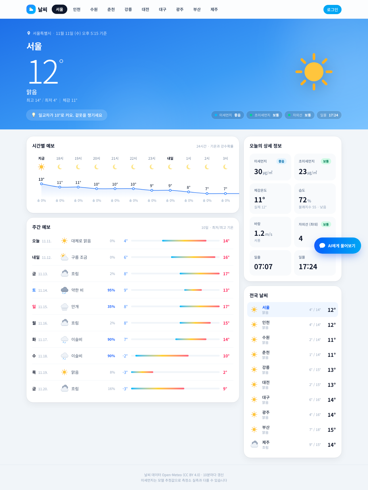
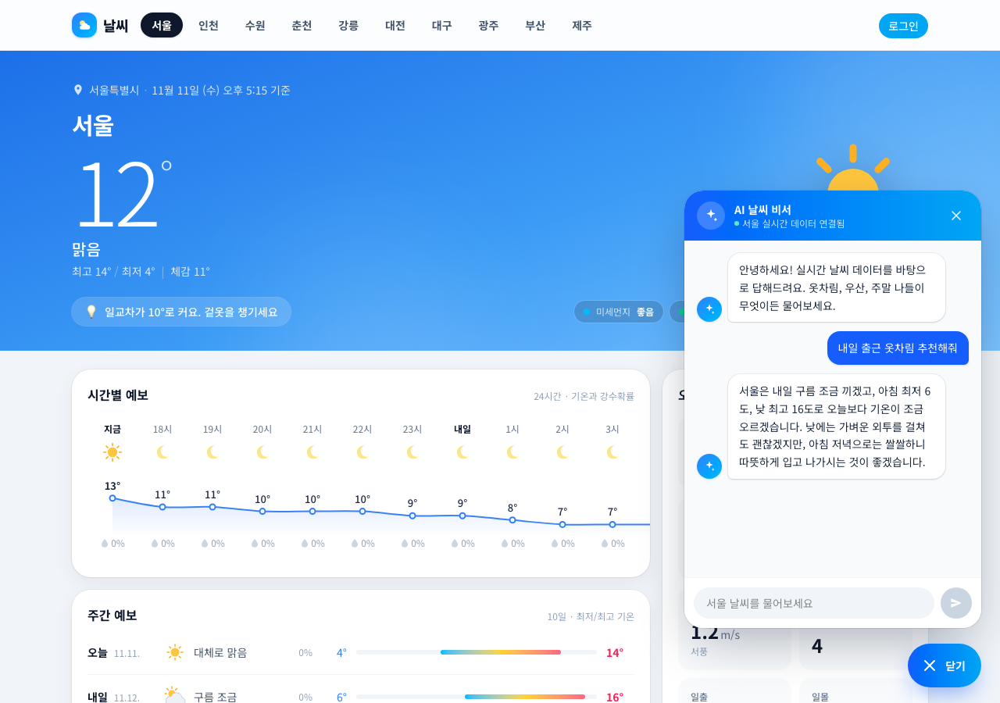
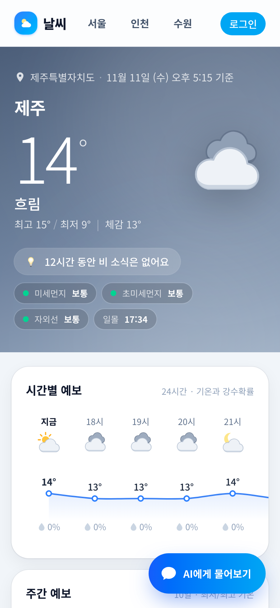
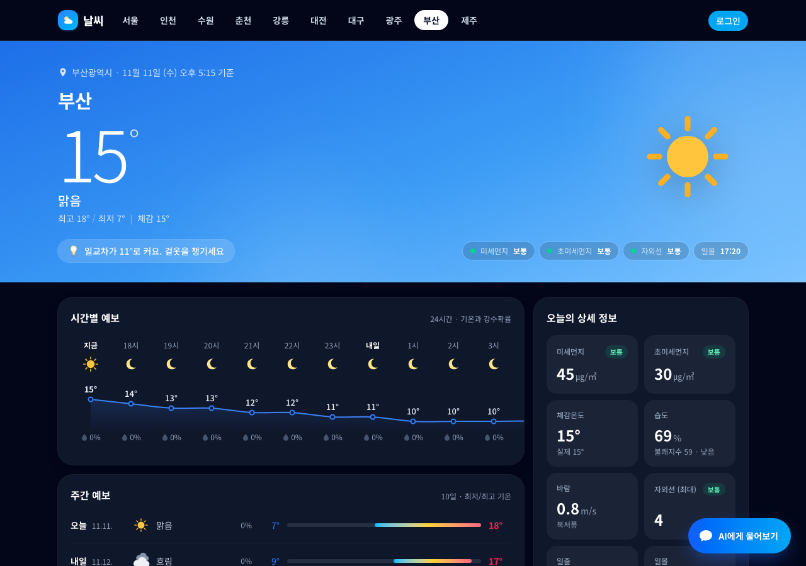
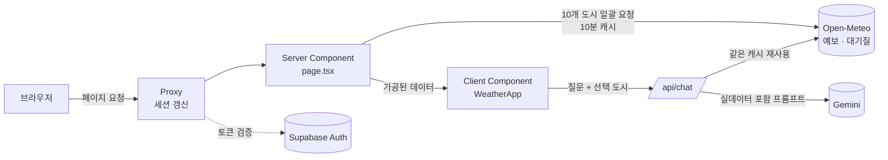

# 날씨 · 실시간 전국 날씨와 AI 날씨 비서

전국 10개 도시의 실시간 날씨, 24시간 기온 그래프, 10일 예보, 미세먼지를 보여주고
**실제 예보 데이터를 근거로 답하는 AI 날씨 비서**가 옷차림·우산·외출 판단을 도와주는 웹 서비스입니다.

네이버 날씨의 정보 구성을 참고해 처음부터 설계했고, 날씨와 낮·밤에 따라 바뀌는 화면, 직접 그린 SVG 아이콘, 모바일·다크 모드까지 지원합니다.

> 배포 주소: _배포 후 추가 예정_



| AI 날씨 비서 | 모바일 | 다크 모드 |
|---|---|---|
|  |  |  |

---

## 목차

1. [주요 기능](#주요-기능)
2. [기술 스택](#기술-스택)
3. [아키텍처](#아키텍처)
4. [설계에서 신경 쓴 부분](#설계에서-신경-쓴-부분)
5. [트러블슈팅](#트러블슈팅)
6. [프로젝트 구조](#프로젝트-구조)
7. [실행 방법](#실행-방법)
8. [데이터 출처와 한계](#데이터-출처와-한계)
9. [앞으로 개선할 점](#앞으로-개선할-점)

---

## 주요 기능

### 실시간 날씨
- **현재 날씨**: 기온, 체감온도, 오늘 최고·최저, 날씨 상태를 크게 보여줍니다. 배경 그라데이션과 아이콘이 날씨(맑음·구름·흐림·안개·비·눈·뇌우)와 낮·밤에 따라 바뀝니다.
- **한 줄 요약**: 다음 12시간 예보를 분석해 "21시쯤 비 소식이 있어요. 우산을 챙기세요", "일교차가 10°로 커요" 같은 생활 문구를 자동으로 만듭니다.
- **시간별 예보**: 24시간 기온을 부드러운 곡선 그래프로 그리고, 시간마다 아이콘과 강수확률을 표시합니다. 마우스를 올린 시간이 강조됩니다.
- **10일 예보**: 요일별 날씨와 강수확률, 최저·최고 기온을 범위 막대로 보여줍니다. 주간 전체 기온 범위를 기준으로 막대 위치를 정해 날짜 간 비교가 쉽습니다. 토요일은 파랑, 일요일은 빨강으로 표시합니다.
- **상세 정보**: 미세먼지·초미세먼지(환경부 등급 기준), 자외선(기상청 단계), 습도와 불쾌지수(기상청 공식), 풍속·풍향, 일출·일몰.
- **전국 날씨**: 서울·인천·수원·춘천·강릉·대전·대구·광주·부산·제주. 선택한 도시는 주소(`?city=busan`)에 반영돼 새로고침·공유해도 유지됩니다.

### AI 날씨 비서
- 화면과 **같은 실시간 데이터**를 프롬프트에 넣어, 모델이 수치를 지어내지 않고 실제 예보를 근거로 답합니다.
- 지역을 말하지 않으면 화면에서 선택한 도시를 기준으로 답합니다.
- 추천 질문, 입력 중 표시, 자동 스크롤, Esc로 닫기를 지원합니다.

### 로그인 (선택)
- Supabase 이메일·비밀번호 로그인과 Google 로그인을 지원합니다.
- Supabase 환경변수가 없거나 Supabase가 일시정지 상태여도 날씨 화면은 로그아웃 상태로 정상 동작합니다.

---

## 기술 스택

| 구분 | 사용 기술 |
|---|---|
| 프레임워크 | Next.js 16 (App Router, Server Components, Route Handlers, Proxy) |
| 언어 | TypeScript |
| UI | React 19, Tailwind CSS 4, 직접 그린 SVG 아이콘·차트 (차트 라이브러리 없음) |
| 날씨 데이터 | [Open-Meteo](https://open-meteo.com/) 예보 API, 대기질 API |
| AI | Google Gemini 2.5 Flash (`@google/genai`) |
| 인증 | Supabase Auth (`@supabase/ssr`) |

---

## 아키텍처



**데이터 흐름**

1. 서버 컴포넌트가 10개 도시의 예보와 대기질을 **요청 2번**으로 한꺼번에 가져옵니다. Open-Meteo는 좌표 여러 개를 쉼표로 묶어 보낼 수 있어서 도시마다 따로 요청하지 않습니다.
2. 응답은 `fetch`의 `next.revalidate`로 **10분간 캐시**되므로 사용자가 늘어도 외부 API 호출 수는 그대로입니다.
3. 날씨 코드(WMO), 등급 계산, 요약 문구 생성은 모두 서버에서 끝내고, 클라이언트는 가공된 데이터만 받습니다. 그래서 도시를 바꿀 때 네트워크 요청 없이 즉시 전환됩니다.
4. 챗봇 API도 같은 함수와 같은 캐시를 쓰므로 화면에 보이는 수치와 AI가 말하는 수치가 항상 일치합니다.

---

## 설계에서 신경 쓴 부분

### 1. AI가 수치를 지어내지 않게 하기
LLM에게 "날씨 알려줘"를 그대로 보내면 그럴듯한 가짜 수치를 만들어냅니다. 그래서 서버에서 10개 도시의 현재 날씨, 3시간 간격 시간별 예보, 7일 예보를 압축한 텍스트를 시스템 프롬프트에 넣고 아래 규칙을 줬습니다.

- 제공된 데이터에 있는 수치만 말하고, 없는 지역·기간은 모른다고 안내할 것
- 지역을 말하지 않으면 화면에서 선택한 지역 기준으로 답하되, 사용자가 그 지역에 있다고 단정하지 말 것
- 날씨 데이터 조회에 실패하면 그 사실을 프롬프트에 알려 수치를 만들지 않게 할 것

### 2. 챗봇 API 보호
공개된 AI API는 비용 폭탄의 통로가 될 수 있어 서버에서 여러 겹으로 막았습니다.

- **입력 검증**: 질문 500자, 대화 기록 12개, 기록 항목의 역할·형식 검사. 도시 ID는 허용 목록과 대조합니다.
- **요청 제한**: IP당 1분 10회. 만료된 기록은 주기적으로 청소해 메모리가 계속 커지지 않게 했습니다.
- **IP 위조 방지**: `x-forwarded-for`의 첫 값은 클라이언트가 조작할 수 있으므로, 배포 플랫폼이 실제로 관측한 마지막 값을 씁니다.
- **API 키는 서버에만**: Gemini 키는 Route Handler에서만 읽고 브라우저로 나가지 않습니다.

### 3. 인증 보안과 장애 내성
- **오픈 리다이렉트 방지**: 로그인 후 이동 경로(`next`)는 `/`로 시작하고 `//`로 시작하지 않는 내부 경로만 허용합니다.
- **리다이렉트 주소 고정**: OAuth·이메일 인증 리다이렉트 주소는 조작 가능한 `Host` 헤더 대신 환경변수(`NEXT_PUBLIC_SITE_URL`)로만 만듭니다. 배포 환경에서 값이 없으면 조용히 localhost로 보내지 않고 눈에 띄게 실패시킵니다.
- **토큰 검증 비용 줄이기**: `getClaims()`로 토큰 서명을 공개키로 검증해, 매 요청마다 Supabase 서버를 왕복하지 않습니다. 한 요청 안의 중복 호출은 React `cache`로 한 번만 실행합니다.
- **Supabase 장애와 분리**: 인증 서버가 죽어도 날씨 화면은 로그아웃 상태로 계속 보여줍니다. 로그인 콜백도 500 대신 안내와 함께 로그인 화면으로 돌려보냅니다.

### 4. 정확한 국내 기준 적용
| 항목 | 기준 |
|---|---|
| 미세먼지 PM10 | 좋음 ≤30, 보통 ≤80, 나쁨 ≤150, 매우나쁨 (㎍/㎥, 환경부) |
| 초미세먼지 PM2.5 | 좋음 ≤15, 보통 ≤35, 나쁨 ≤75, 매우나쁨 (㎍/㎥, 환경부) |
| 자외선 | 낮음 ≤2, 보통 ≤5, 높음 ≤7, 매우높음 ≤10, 위험 (기상청) |
| 불쾌지수 | 0.81T + 0.01H(0.99T − 14.3) + 46.3 (기상청) |

### 5. 차트 라이브러리 없이 SVG로 직접 구현
- 시간별 기온 곡선은 Catmull-Rom 스플라인을 베지어 곡선으로 변환해 그렸습니다.
- 기온과 강수확률은 단위가 달라 한 그래프에 축 두 개로 겹치지 않고, 강수확률은 숫자로 따로 표시했습니다.
- 마우스 반응 영역을 표시 요소보다 넓게 잡아 작은 점을 정확히 겨누지 않아도 됩니다.

### 6. 접근성과 반응형
- 등급은 색만으로 구분하지 않고 항상 "좋음·보통" 같은 글자를 함께 씁니다.
- 아이콘에 `role="img"`와 설명을, 버튼에 `aria-label`·`aria-pressed`·`aria-expanded`를 붙였습니다.
- 모바일에서는 주간 예보를 숫자 위주로 바꾸고, 챗봇 창을 화면 폭에 맞춥니다.

---

## 트러블슈팅

### 휴대폰으로 접속하면 화면은 보이는데 아무 버튼도 안 눌림
- **현상**: `http://192.168.x.x:3000`으로 접속하면 화면은 그려지지만 도시 선택, 챗봇 버튼이 전혀 반응하지 않았습니다.
- **원인**: 서버 로그에 `Blocked cross-origin request to Next.js dev resource`가 찍혀 있었습니다. Next.js 16은 개발 서버의 JS 파일을 다른 출처에서 요청하면 기본 차단합니다. HTML은 받았지만 JS가 막혀 React가 이벤트를 연결(hydration)하지 못한 것이었습니다.
- **해결**: `next.config.ts`의 `allowedDevOrigins`에 사설망 대역을 추가했습니다.

### 휴대폰에서 AI 추천 질문을 눌러도 전송되지 않음
- **현상**: PC(localhost)에서는 되는데 휴대폰에서만 질문이 전송되지 않았습니다.
- **원인**: 브라우저 로그를 서버로 전달해 확인해보니 `crypto.randomUUID is not a function`이었습니다. 이 함수는 **보안 컨텍스트(https 또는 localhost)에서만** 존재해서, `http://192.168...` 접속에서는 클릭 즉시 오류가 났습니다.
- **해결**: 메시지 ID를 시각과 증가 번호로 만드는 방식으로 바꿨습니다.

### 긴 AI 답변 뒤에 모든 질문이 실패함
- **현상**: AI가 길게 답한 다음부터 질문마다 "history 형식이 올바르지 않습니다" 오류가 났습니다.
- **원인**: 대화 기록 검증이 사용자 질문 제한(500자)을 AI 답변에도 똑같이 적용하고 있었습니다. AI는 최대 1024토큰까지 답할 수 있어 500자를 쉽게 넘깁니다.
- **해결**: 역할별로 제한을 나눴습니다(사용자 500자, AI 4000자). 제한값은 화면과 서버가 같은 파일을 import하게 해서 한쪽만 바뀌는 일을 막았습니다.

### 그 밖에 고친 챗봇 문제
- **오류 안내가 AI의 말로 기억됨**: 실패 시 띄운 "문제가 발생했어요" 문구가 다음 요청에 AI의 이전 답변으로 전송됐습니다. 실패한 질문과 안내문에 표시를 붙여 화면에만 보이고 AI에게는 보내지 않게 했습니다.
- **더블클릭 시 중복 전송**: `isSending` 상태는 다음 렌더링 전까지 바뀌지 않아 빠른 연속 클릭을 막지 못했습니다. `useRef`로 즉시 잠그도록 바꿨습니다.
- **답변이 중간에 잘림**: Gemini 2.5 Flash는 출력 토큰 예산을 내부 추론(thinking)에 먼저 씁니다. 짧은 답변에는 필요 없어 `thinkingBudget: 0`으로 꺼서 해결했습니다.

### 기상청 API 연동을 시도했다가 뺀 이유
기상청 단기·중기예보와 에어코리아 실측 미세먼지를 연동하는 코드를 작성하고, 실제 응답 형식을 흉내 낸 테스트 21개로 검증까지 했습니다. 위경도→기상청 격자 변환, 발표 시각 계산, 일부 API 실패 시 Open-Meteo로 대체하는 구조였습니다.
하지만 공공데이터포털 서비스키 발급과 개발계정 호출 한도 관리가 필요했고, 포트폴리오 단계에서는 키 없이 누구나 바로 실행할 수 있는 쪽이 더 중요하다고 판단해 Open-Meteo로 단순화했습니다. 상업 서비스로 전환할 때 다시 도입할 후보입니다.

---

## 프로젝트 구조

```
src/
├── app/
│   ├── page.tsx                 # 날씨 데이터를 서버에서 가져와 화면에 전달
│   ├── layout.tsx               # 폰트, 메타데이터(링크 미리보기)
│   ├── api/chat/route.ts        # AI 날씨 비서 API (검증, 요청 제한, Gemini 호출)
│   ├── login/                   # 로그인·회원가입 페이지와 Server Actions
│   ├── auth/callback/route.ts   # 이메일 인증·Google 로그인 콜백
│   ├── icon.svg, apple-icon.png # 파비콘, iOS 홈 화면 아이콘
│   └── opengraph-image.png      # 링크 공유 미리보기 이미지
├── components/
│   ├── weather/
│   │   ├── WeatherApp.tsx       # 전체 레이아웃, 도시 선택 상태
│   │   ├── CurrentHero.tsx      # 현재 날씨 영역
│   │   ├── HourlyForecast.tsx   # 24시간 기온 SVG 그래프
│   │   ├── WeeklyForecast.tsx   # 10일 예보와 기온 범위 막대
│   │   ├── DetailGrid.tsx       # 미세먼지·자외선·습도 등 상세 카드
│   │   ├── CityList.tsx         # 전국 날씨 목록
│   │   └── WeatherIcon.tsx      # 날씨·낮밤별 SVG 아이콘
│   ├── chat/ChatWidget.tsx      # AI 날씨 비서 채팅창
│   └── auth/AuthStatus.tsx      # 로그인 상태 표시
├── lib/
│   ├── weather-api.ts           # Open-Meteo 호출·가공, 요약 문구, 챗봇용 데이터
│   ├── weather-style.ts         # 날씨 코드 해석, 등급 계산, 배경색
│   ├── locations.ts             # 도시 목록과 좌표
│   ├── chat-limits.ts           # 챗봇 길이 제한 (화면·서버 공용)
│   └── supabase/                # Supabase 설정 확인, 서버 클라이언트, 현재 사용자
├── types/weather.ts             # 날씨 데이터 타입
└── proxy.ts                     # 요청마다 로그인 세션 갱신
```

---

## 실행 방법

### 요구 사항
- Node.js 20.9 이상
- [Gemini API 키](https://aistudio.google.com/apikey) (AI 날씨 비서용, 무료 등급 사용 가능)
- Supabase 프로젝트 (선택, 로그인 기능용)

날씨 데이터는 Open-Meteo를 쓰므로 **날씨 API 키는 필요 없습니다.**

### 설치와 실행

```bash
git clone <저장소 주소>
cd <저장소 폴더>
npm install
cp .env.example .env.local   # 값 채우기
npm run dev
```

브라우저에서 http://localhost:3000 을 엽니다.
같은 와이파이의 휴대폰에서는 터미널에 표시되는 `Network` 주소(예: `http://192.168.0.10:3000`)로 접속할 수 있습니다.

### 환경변수

| 이름 | 필수 | 설명 |
|---|---|---|
| `GEMINI_API_KEY` | AI 비서 사용 시 | Google Gemini API 키. 없으면 날씨 화면은 동작하고 챗봇만 오류 안내를 띄웁니다. |
| `NEXT_PUBLIC_SUPABASE_URL` | 로그인 사용 시 | Supabase 프로젝트 주소 |
| `NEXT_PUBLIC_SUPABASE_ANON_KEY` | 로그인 사용 시 | Supabase 공개(anon) 키 |
| `NEXT_PUBLIC_SITE_URL` | 배포 시 | 배포 주소. 인증 리다이렉트와 링크 미리보기 이미지 주소에 사용. 로컬에서는 비워두면 `http://localhost:3000` |

### 스크립트

| 명령 | 설명 |
|---|---|
| `npm run dev` | 개발 서버 |
| `npm run build` | 프로덕션 빌드 |
| `npm run start` | 프로덕션 서버 |
| `npm run lint` | ESLint 검사 |

---

## 데이터 출처와 한계

- 날씨·대기질 데이터: [Open-Meteo](https://open-meteo.com/) ([CC BY 4.0](https://creativecommons.org/licenses/by/4.0/)). 화면 하단에 출처를 표시합니다.
- **미세먼지는 모델 추정값**이라 에어코리아 측정소 실측값과 다를 수 있습니다. 화면에도 같은 안내를 표시합니다.
- Open-Meteo 무료 API는 **비상업용**입니다. 상업 서비스로 운영하려면 Open-Meteo 유료 플랜이나 기상청·에어코리아 API로 바꿔야 합니다.
- 챗봇 요청 제한은 서버 메모리에 저장하므로, 서버리스처럼 인스턴스가 여러 개 뜨는 환경에서는 인스턴스별로 따로 계산됩니다.

---

## 앞으로 개선할 점

- [ ] 브라우저 위치 정보로 **내 위치 날씨**, 읍·면·동 단위 지역 검색
- [ ] 로그인 사용자의 **즐겨찾는 지역 저장**과 아침 날씨 알림
- [ ] AI 답변을 한 글자씩 보여주는 **스트리밍 응답**
- [ ] 옷차림·세차·빨래·운동 같은 **생활 지수 카드**
- [ ] 요청 제한을 Upstash Redis 같은 공유 저장소로 이전
- [ ] PWA로 홈 화면 설치 지원
- [ ] 날씨 가공 로직 단위 테스트 추가
